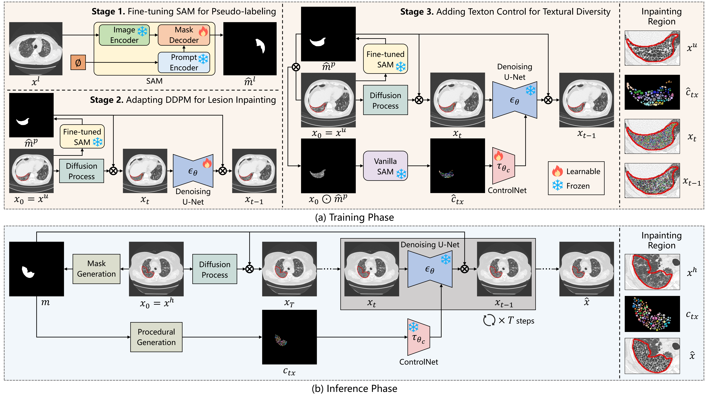

# DiffTexture

DiffTexture is the code release for *DiffTexture: A texton-controlled inpainting framework for synthesizing pulmonary lesions with structural textures*.

## Framework



## Visualization


## Install

```bash
pip install -e '.[dev]'
```

Use a PyTorch build compatible with your CUDA environment before installation.

## Data format

Create a JSONL manifest with paths relative to the manifest file:

```json
{"id": "case-001", "image": "images/case-001.png", "mask": "masks/case-001.png", "texton_map": "textons/case-001.png"}
```

`image` is a single CT slice (grayscale or RGB), `mask` is binary with white
pixels indicating the inpainting region, and `texton_map` is an integer or
binary map. Images are converted to RGB; masks are binarized. Details are in
[`docs/DATA_FORMAT.md`](docs/DATA_FORMAT.md).

## Commands

```bash
# 1. Generate texton maps from existing lesion masks.
python scripts/generate_texton_maps.py --manifest train.jsonl --output-dir textons \
  --config configs/procedural/honeycombing.yaml

# 2. Train the main context-aware DDPM.
accelerate launch scripts/train_ddpm_inpainting.py \
  --manifest train.jsonl --output-dir outputs/inpainting

# 3. Train texton control with a frozen main checkpoint.
accelerate launch scripts/train_texton_control.py \
  --manifest train.jsonl --inpainting-checkpoint outputs/inpainting/checkpoint-100000 \
  --output-dir outputs/texton_control

# 4. Controlled inference.
python scripts/infer_texton_control.py --image normal_ct.png --mask region.png \
  --texton-map texton.png --inpainting-checkpoint path/to/unet \
  --control-checkpoint path/to/controlnet --output result.png
```

For the uncontrolled baseline, use `scripts/infer_ddpm_inpainting.py`.